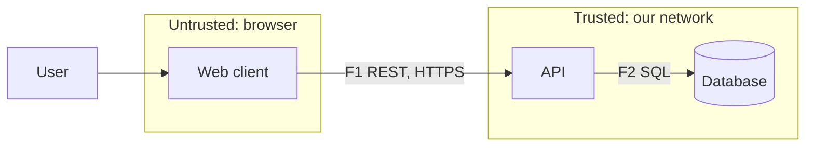

# Threat model template

Copy the block under "Template" to `docs/security/threat-model.md`, replace the sample content, keep it under about 300 lines. The sample rows are illustrative and pass the linter in [tm-lint.md](tm-lint.md) once `last_reviewed` holds a real date (the placeholder date is deliberately rejected). Delete sample rows that do not apply.

## Rules for the file

- One diagram, one threat table, plain markdown: it must diff and review well in a PR.
- Reference `.agents/security-project-context.md` for roles, tenancy, environments and scope instead of copying them; copy only what the threat analysis needs.
- No secrets, real customer data or production hostnames.
- Threat ids are `T-001` style, never reused; retire a threat by setting status `eliminated`, not by deleting the row.
- Status values: `planned`, `implemented`, `accepted`, `transferred`, `eliminated`. `implemented` requires a passing test or a cited code location. `accepted` requires a named owner in the Why cell and a revisit trigger.

## Diagram conventions (mermaid flowchart, validated by the linter and by mermaid 11)

- First line: `flowchart LR` (or `TD`).
- One `subgraph id ["label"]` per trust zone, closed with `end`. Name zones by trust, for example `Untrusted: browser`, `Trusted: our VPC`, `Semi-trusted: third parties`.
- Shapes: `[...]` process or external entity, `[(...)]` data store. Always quote labels (`["..."]`) when they contain parentheses, colons or punctuation; unquoted parentheses are a parse error.
- Label every flow with an id and protocol: `-->|"F1 login, HTTPS"|`. Use the flow ids in the threat table `Where` column.
- Keep it to what fits on one screen; split by feature rather than adding every class.
- Node ids are plain alphanumerics; no reserved word `end` as an id.

## Update triggers (put a line like this in the file)

Review the model when a PR adds or changes: a route group or public endpoint, an authentication or role concept, a data store or queue, a third-party integration or webhook, file upload or download, an LLM or agent component, a deployment boundary (new service, new network zone), or a new class of personal data. Use [diff mini-mode](diff-mini-mode.md) for single PRs; a full review at least when `last_reviewed` is older than your release cadence says (state it in the file).

## Template

````markdown
# Threat model: <system or feature>

```yaml
scope: <what is in, what is out>
owner: <team or person>
last_reviewed: YYYY-MM-DD
review_trigger: new route group, new third party, new role, new data store, auth change
context_file: .agents/security-project-context.md
```

## 1. Assets and actors

| Asset | Why an attacker wants it | Data class |
| --- | --- | --- |
| <asset> | <reason> | <class> |

| Actor | Privilege | Notes |
| --- | --- | --- |
| Anonymous visitor | none | <reachable surface> |

## 2. Data-flow diagram



Boundary crossings analysed: <list flow ids>. Not analysed, with reason: <list>.

## 3. Threats

Scale: impact 1-3, likelihood 1-3, risk = product (Low 1-2, Medium 3-4, High 6-9).

| ID | Where | Category | Abuse case | Impact | Likelihood | Risk | Why | Mitigation | Status | Test |
| --- | --- | --- | --- | --- | --- | --- | --- | --- | --- | --- |
| T-001 | F1 | Elevation of privilege | A user requests another user's record by changing the id in the URL | 3 | 3 | High (9) | Ids are guessable, any account can try, data of others is exposed. Judgement | Scope every query by the session user in the data layer | planned | Authorization test with two users: user B gets 404 for user A's id |
| T-002 | F2 | Tampering | Request input reaches a query unescaped | 3 | 1 | Medium (3) | Needs a missing parameterisation; ORM used everywhere, one raw query exists | Parameterised queries only; lint rule against raw string SQL | planned | Unit test: input containing a quote character is stored literally and returns no extra rows |

## 4. Open questions and assumptions

- A1: <thing the code did not show, and who confirms>

## 5. Handoffs

- <threat ids> to the authorization / security unit tests; <ids> to `security-regression-generation`; risk input to `security-test-strategy`.

## 6. Changelog

- YYYY-MM-DD: initial model.
````
