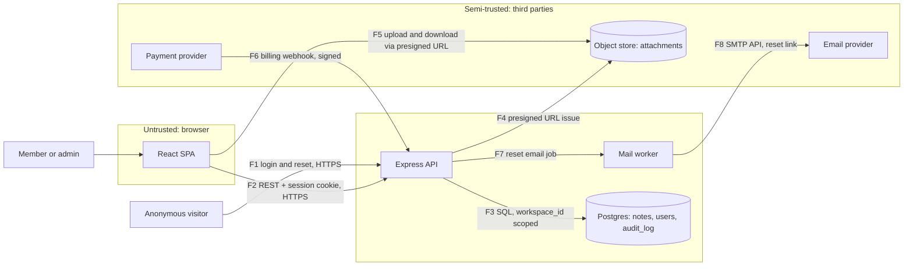

# Worked example: Notekeeper (small web + API app)

Synthetic app. Everything below the rule is the content of a complete `docs/security/threat-model.md`. It was checked with the linter in [tm-lint.md](tm-lint.md) (0 problems) and its diagram was parsed with mermaid 11 (see tm-lint.md). Paths, routes and the payment provider are invented.

How the model was derived (steps 2-3 of the workflow): `src/routes/*.ts` gave the entry points, `src/db/schema.sql` the stores and the `workspace_id` column on every tenant table, `src/webhooks/billing.ts` the inbound third-party flow, `infra/storage.tf` the bucket and presigned-URL TTL, `src/mail/reset.ts` the outbound email flow. Marked `assumed` where the code was silent.

---

# Threat model: Notekeeper

```yaml
scope: whole system, API v1 and SPA
owner: platform team
last_reviewed: 2026-11-25
review_trigger: new route group, new third party, new role, new data store, auth change
context_file: .agents/security-project-context.md
```

## 1. Assets and actors

| Asset | Why an attacker wants it | Data class |
| --- | --- | --- |
| Notes and attachments | Business-confidential content of every workspace | confidential |
| Session cookies and reset tokens | Account takeover | credential |
| Billing state (plan, seats) | Free upgrade, downgrade of others | financial |
| Member emails and names | Phishing, linking identities | personal |

| Actor | Privilege | Notes |
| --- | --- | --- |
| Anonymous visitor | none | can reach login, reset, webhook URL |
| Member | read/write own workspace | many per workspace |
| Workspace admin | manage members of own workspace | |
| Platform staff | support read access via admin console | assumed, not in repo |
| Payment provider | calls webhook | trusted only after signature check |

## 2. Data-flow diagram



Boundary crossings analysed: F1, F2, F5, F6, F8 (outside-in or tenant-sensitive) and F3, F4 (store access). F7 is inside one zone and carries a reset link, covered by T-006.

## 3. Threats

Scale: impact 1-3, likelihood 1-3, risk = product (Low 1-2, Medium 3-4, High 6-9).

| ID | Where | Category | Abuse case | Impact | Likelihood | Risk | Why | Mitigation | Status | Test |
| --- | --- | --- | --- | --- | --- | --- | --- | --- | --- | --- |
| T-001 | F1 login | Spoofing | Attacker replays leaked credential lists against `/api/login` to take over member accounts | 3 | 2 | High (6) | Exposed to the internet; credential reuse is common; takeover exposes a whole workspace. Judgement: automated, low skill | Per-account and per-IP throttling with backoff in `src/auth/limiter.ts`; generic error text; documented in ASVS 5.0.0 6.1.1 and 6.3.1 | planned | Integration test with fake clock: Nth failed login for one account returns 429 and a correct password during lockout is also refused; same message for unknown user |
| T-002 | F2 / F3 notes | Elevation of privilege | Member of workspace A requests `GET /api/notes/:id` with an id from workspace B and reads it | 3 | 3 | High (9) | Ids are sequential; any member can try; direct cross-tenant leak of confidential data (CWE-639) | Query always scoped by session `workspace_id` in `src/db/notes.ts`; 404 not 403 on mismatch; ASVS 5.0.0 8.2.2 and 8.4.1 | planned | Authorization matrix test: users A1, B1 on every `/api/notes/*` verb; B1 gets 404 on A1's note ids, A1's count unchanged after B1 write |
| T-003 | F2 members | Elevation of privilege | Member sends `PATCH /api/members/:id` with `role: admin` for themselves (mass assignment) | 3 | 2 | High (6) | Needs an authenticated account and request editing; role field is on the same model as profile fields | Server-side allowlist of writable fields; role change requires admin check in one middleware; ASVS 5.0.0 8.2.1 and 8.3.1 | planned | Authorization test: member PATCH with `role` returns 403 and DB role unchanged; admin succeeds; unit test that the allowlist excludes `role` for non-admin |
| T-004 | F6 webhook | Tampering | Anonymous caller posts a fake "payment succeeded" event to upgrade a workspace free | 2 | 2 | Medium (4) | URL is guessable from docs; effect is financial but bounded to one plan; judgement | Verify provider signature over the raw body and reject stale timestamps in `src/webhooks/billing.ts`; idempotency on event id | planned | Unit tests: missing signature, bad signature and 10-minute-old timestamp each return 400 with no DB write; replayed event id is a no-op |
| T-005 | F4 / F5 attachments | Information disclosure | Holder of an old shared presigned URL keeps reading an attachment after being removed from the workspace | 2 | 2 | Medium (4) | URLs are bearer secrets; current TTL is 7 days (assumed from `infra/storage.tf`); leaks via chat or logs | TTL of 5 minutes, random object keys, bucket denies public access; URL issued only after a notes authorization check | planned | Config assertion on bucket block-public-access and TTL constant; integration test: removed member cannot obtain a new URL |
| T-006 | F7 / F8 reset | Spoofing | Attacker triggers reset with a forged `Host` header so the emailed link points to an attacker site and captures the token | 3 | 1 | Medium (3) | Needs the victim to click; only works if the link is built from the request host | Build link from configured `APP_BASE_URL`, never from headers; token single-use, short expiry, not logged | planned | Unit test: request with `Host: attacker.test` still yields the configured base URL in the queued email; log scrubber test for token |
| T-007 | F2 members | Repudiation | Admin removes members or exports notes and later denies it; nothing shows who did it | 2 | 2 | Medium (4) | Insider or compromised admin; no audit rows exist for these actions today; ASVS 5.0.0 16.3.2 covers failed authorization attempts only; no ASVS id is cited for auditing successful admin actions | Append-only `audit_log` rows with actor, action, target, time written in the same transaction | planned | Integration test: each admin action writes exactly one audit row with the actor id; test that the API has no update or delete on `audit_log` |
| T-008 | F5 upload | Denial of service | Member uploads very large or many files, or requests an expensive full-text search in a loop, exhausting storage or DB | 2 | 2 | Medium (4) | Any member can do it; CWE-770; blast radius limited to availability and cost; ASVS 5.0.0 5.2.1 and 15.1.3 | Max size in the presign conditions, per-workspace quota, search page-size cap and statement timeout; review limits from config, no load test | planned | Unit test: presign request over the limit is refused; config assertion on statement timeout and page-size cap |
| T-009 | F2 / SPA render | Tampering | Member stores note markup that runs script in another member's browser (stored XSS) and steals their session | 3 | 2 | High (6) | Notes are shared inside a workspace; renderer currently uses `dangerouslySetInnerHTML` (assumed); ASVS 5.0.0 3.2.2 | Sanitise on render with a maintained sanitiser or render as text; `HttpOnly` and `SameSite` session cookie; CSP | planned | Component test: note containing `` renders with no handler attribute and `window.__tm` stays undefined |
| T-010 | F2 analytics | LINDDUN data disclosure | Frontend analytics sends note titles and member emails to a third-party tracker, linking people to content | 2 | 2 | Medium (4) | Third party is outside our control; personal data and confidential titles; ASVS 5.0.0 14.2.3 | Event allowlist with no titles or emails; hashed internal ids only; consent per privacy policy | planned | Unit test on the analytics wrapper: payloads containing `title` or `email` keys are dropped; network-mock test in the SPA |
| T-011 | Admin console | Elevation of privilege | Platform staff member browses customer notes beyond what support needs | 2 | 1 | Low (2) | Accepted by owner platform-lead. Few staff, background-checked; console not in this repo (assumed) | Accepted for now: access is logged by the console vendor | accepted | None: accepted; revisit when staff count exceeds 10 or the console moves into this repo |

## 4. Open questions and assumptions

- A1: Presigned URL TTL read from `infra/storage.tf`; confirm deployed value.
- A2: SPA note renderer assumed to use raw HTML insertion; confirm in `src/ui/NoteView.tsx`.
- A3: Admin console is out of this repo and out of scope.

## 5. Handoffs

- High threats T-001, T-002, T-003, T-009: tests above go to the authorization-test and security-unit-test workflow; once fixed, `security-regression-generation` records red-then-green evidence.
- `security-test-strategy` receives T-001..T-010 as its risk input; domain checks: `api-security-testing` (T-002, T-003, T-004, T-008), `web-security-testing` (T-009, T-006).

## 6. Changelog

- 2026-11-25: initial model.
